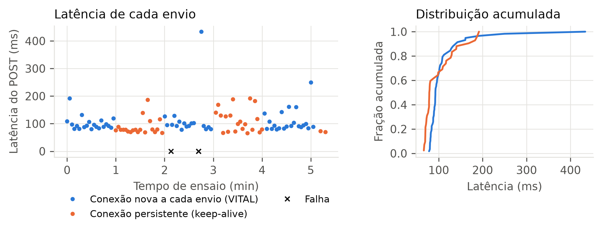
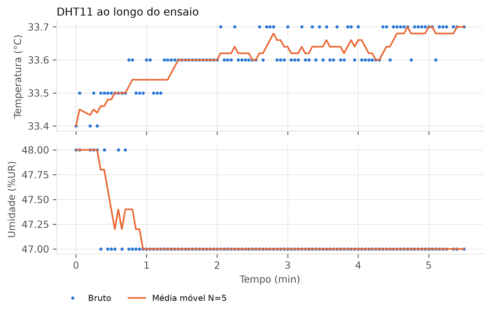

# VITAL — Resultados da avaliação quantitativa

Gerado automaticamente por `avaliacao/analisar.py` a partir dos dados em `avaliacao/dados/`.

## 1. Inclinação estática

_Sem dados ainda (rode `coletar.py inclinacao`)._

## 2. Resposta ao degrau

_Sem dados ainda (rode `coletar.py degrau`)._

## 3. Comunicação Wi-Fi (HTTP)

Arquivo: `wifi_20261112_174248.csv` — blocos alternados de ~1 min entre os dois modos (3 com conexão nova, 2 com conexão persistente), envio a cada 3 s, duração 5,3 min.

**Tabela 4 – Desempenho da comunicação**

| Modo | Envios | Entregues | Taxa de entrega (%) | Latência média (ms) | Desvio (ms) | Mediana (ms) | P95 (ms) | Máx. (ms) |
|---|---|---|---|---|---|---|---|---|
| Conexão nova a cada envio (VITAL) | 61 | 58 | 95,08 | 108,6 | 52,7 | 92,6 | 165,6 | 433,7 |
| Conexão persistente (keep-alive) | 42 | 42 | 100,00 | 99,4 | 38,1 | 79,0 | 186,2 | 191,7 |

Mann-Whitney U (latência): U = 1619, p = 0,005; redução da mediana com conexão persistente: 14,7%. Teste exato de Fisher (taxa de entrega): p = 0,268.

## 4. DHT11 (temperatura e umidade)

Arquivo: `dht_20261112_174248.csv` — 107 tentativas de leitura em 5,5 min; taxa de leituras válidas: 100,00%. Sem instrumento de referência: a exatidão considerada é a do fabricante (±2 °C e ±5 %UR); avaliam-se estabilidade e ruído.

**Tabela 5 – Estabilidade das leituras do DHT11**

| Grandeza | Método | Média | Mín. | Máx. | Ruído σ (sem tendência) | Variação média entre leituras | Resolução observada |
|---|---|---|---|---|---|---|---|
| Temperatura (°C) | Bruto | 33,61 | 33,40 | 33,70 | 0,05 | 0,04 | 0,10 |
| Temperatura (°C) | Média móvel N=5 | 33,61 | 33,40 | 33,70 | 0,03 | 0,01 | – |
| Umidade (%UR) | Bruto | 47,07 | 47,00 | 48,00 | 0,23 | 0,07 | 1,00 |
| Umidade (%UR) | Média móvel N=5 | 47,09 | 47,00 | 48,00 | 0,20 | 0,02 | – |

## 5. Autoaquecimento do DHT11 (partida a frio)

_Sem dados ainda (`coletar.py aquecimento`)._

## 6. Custo computacional no ESP32 (80 MHz)

Arquivo: `bench_20261112_172551.csv` — 20 000 iterações × 5 repetições por método (menor tempo).

**Tabela 7 – Custo de cada método**

| Método | Tempo por amostra (µs) | Memória de estado (bytes) | Uso da CPU a 50 Hz (%) |
|---|---|---|---|
| M1 Bruto (sem filtro) | 8,885 | 0 | 0,0444 |
| M2 EMA α=0,1 (VITAL) | 9,479 | 12 | 0,0474 |
| M3 Média móvel N=20 | 11,670 | 256 | 0,0584 |
| M4 Kalman 1D | 10,188 | 8 | 0,0509 |
